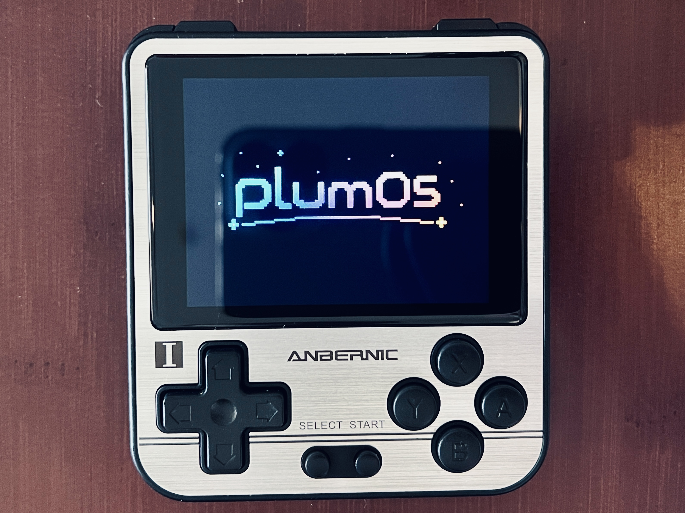
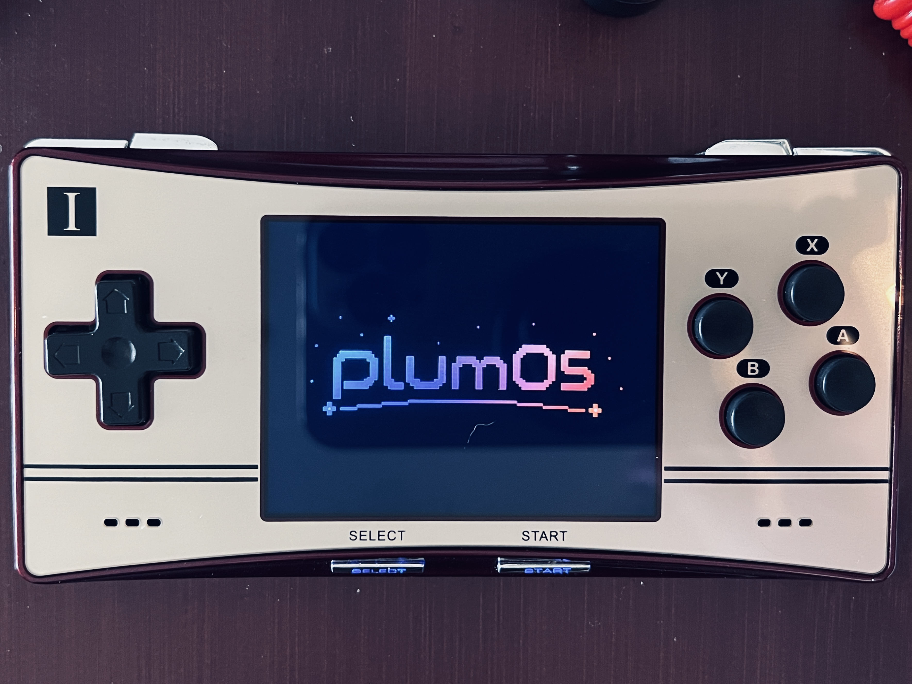
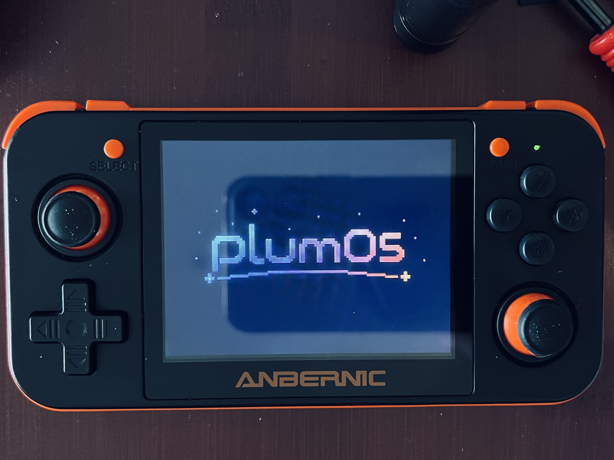
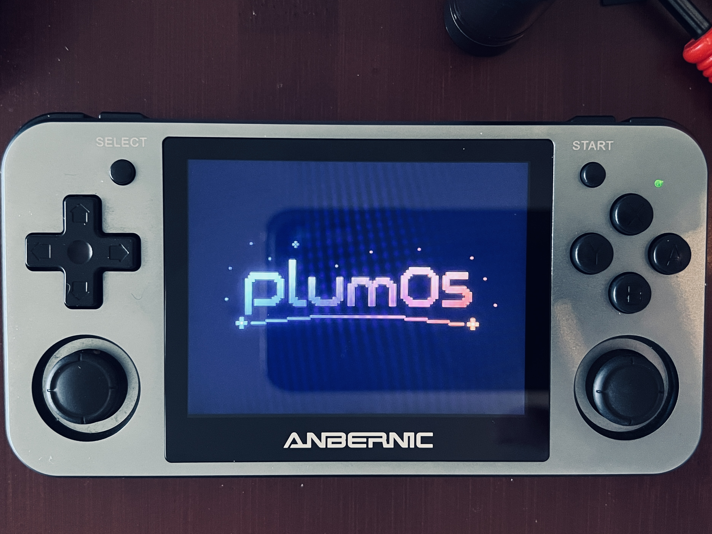

# plumOS JZ47xx_v2

[English](README.md)

| RG280V | RG300X | RG350 | RG350M |
| :---: | :---: | :---: | :---: |
|  |  |  |  |

plumOS JZ47xx_v2は、Anbernic RG280V・RG300X・RG350・RG350M向けのカスタムファームウェアです。1枚のシステムカード（SD1）を4機種で共用できます。plumOSのフロントエンドから単体エミュレータとPicoArchコアを起動でき、別のカード（SD2）にゲームとサムネイルを置けます。

リポジトリ名は `plumOS-jz47xx_v2`、初回リリースのバージョンは `v0.1.0` です。

- [ユーザーガイド](docs/user/README.ja.md) — SDカードへの書き込み、機種の選択、ゲームの追加、フロントエンドの操作、SD1からの更新。
- [開発者ガイド](docs/developer/README.ja.md) — 基盤のビルド、共通の起動構成、配布用イメージの準備。

開発リポジトリには実機検証用のイメージ生成手順が含まれます。通常の導入には、公開された検証済みのリリースイメージを使用してください。

plumOS独自の成果物は [MITライセンス](LICENSE) です。上流ソフトウェア、その変更パッチ、第三者の素材には、それぞれのライセンス条件が適用されます。

[第三者ライセンス表記と対応ソースの状況](THIRD_PARTY_NOTICES.ja.md)
