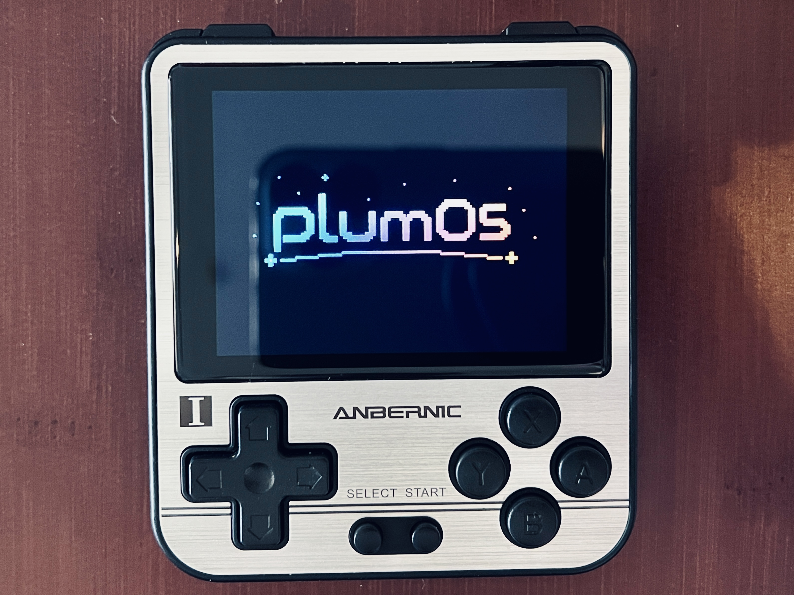
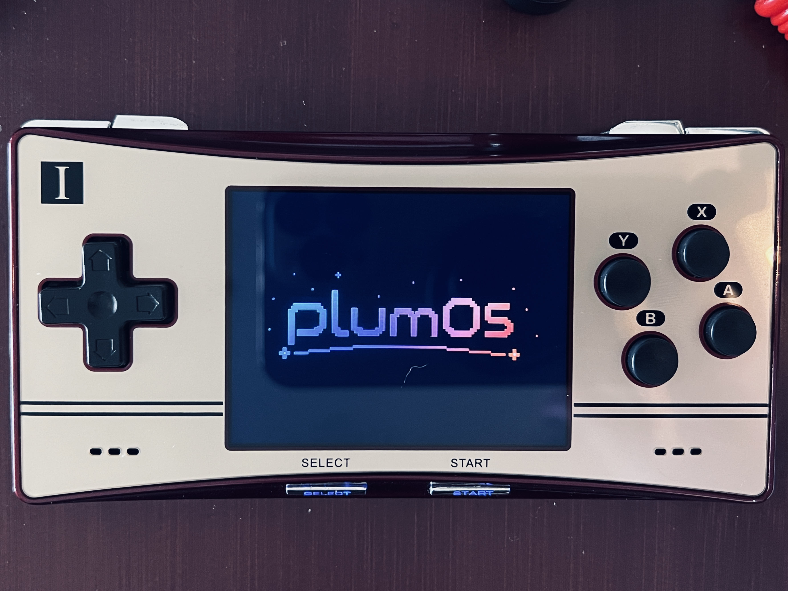
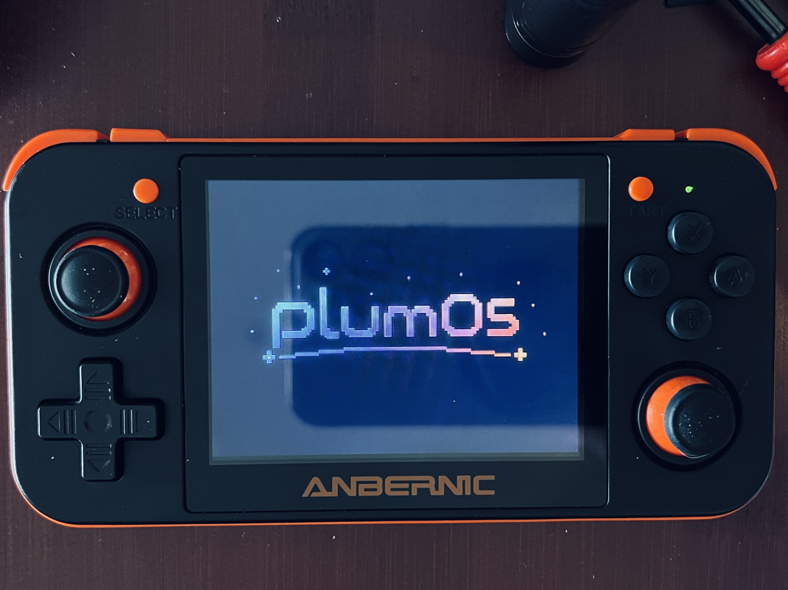
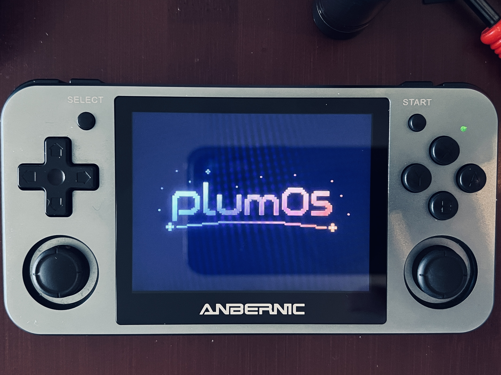

# plumOS JZ47xx_v2

[日本語](README.ja.md)

| RG280V | RG300X | RG350 | RG350M |
| :---: | :---: | :---: | :---: |
|  |  |  |  |

plumOS JZ47xx_v2 is custom firmware for the Anbernic RG280V, RG300X, RG350 and RG350M. A shared system card (SD1) works across all four models. The plumOS frontend launches standalone emulators and PicoArch cores, and uses an optional second card (SD2) for games and artwork.

The repository is named `plumOS-jz47xx_v2`. The initial release version is `v0.1.0`.

- [User guide](docs/user/README.md) — Write an SD card, select a model, add games and use the frontend.
- [Developer guide](docs/developer/README.md) — Build the base system, understand the shared boot flow and prepare a clean release.

The development checkout includes a hardware-validation image workflow. Use a verified public release image for normal installation when one is available.

plumOS-authored material is available under the [MIT License](LICENSE). Upstream software, patches to upstream components and third-party assets retain their applicable terms.

[Third-party notices and source status](THIRD_PARTY_NOTICES.md)
