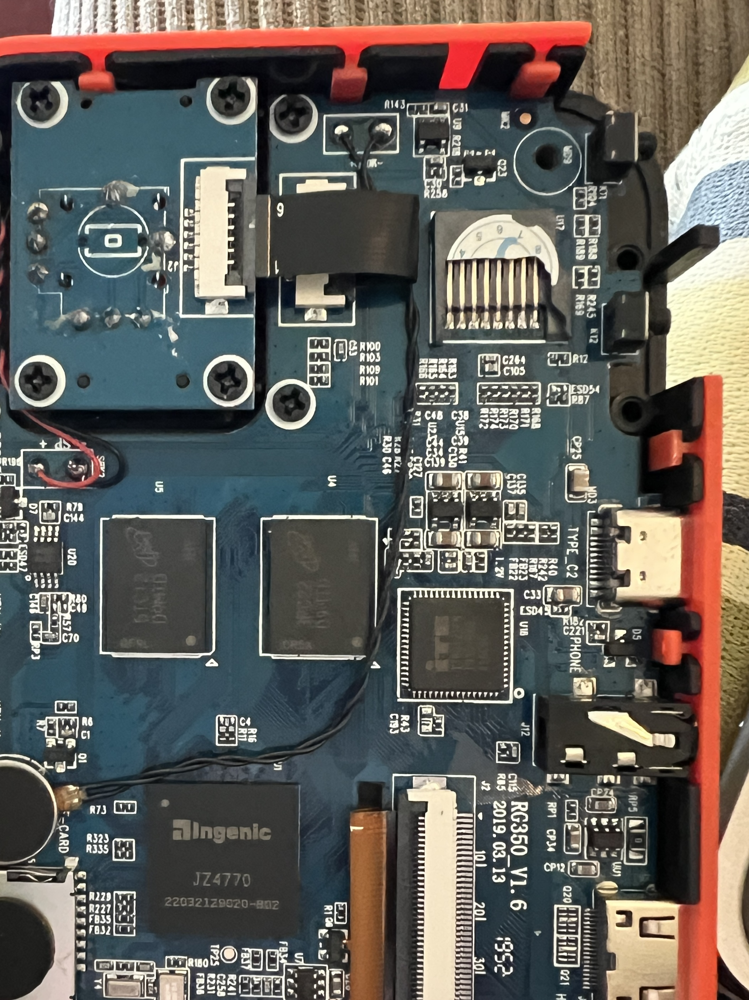

# plumOS JZ47xx_v2 ユーザーガイド

[English](README.md) · [プロジェクト概要](../../README.ja.md)

[対応システムとROMフォルダー](supported-systems.ja.md) · [SDカード構成](storage.ja.md) · [セーブの保存先とバックアップ](save-data.ja.md)

## SD1にインストールする

RG280V・RG300X・RG350・RG350Mのいずれかと、4 GB以上のmicroSDカード、カードリーダーを用意します。元のシステムカードは復旧用に保管してください。イメージを書き込むと、書き込み先のセーブや設定も消去されます。

1. 同じリリースから `plumOS-JZ47xx-v0.1.0-sd-image.7z` と `SHA256SUMS` を取得します。
2. 書き込み前にSHA-256を確認します。ファイル単体の確認には、macOSでは `shasum -a 256 <イメージファイル>`、Linuxでは `sha256sum <イメージファイル>`、PowerShellでは `Get-FileHash <イメージファイル> -Algorithm SHA256` を使い、公開された値と照合します。
3. 7-Zipアーカイブから `plumOS-JZ47xx-0.1.0.img` を展開し、ディスクイメージ書き込みツールでIMGを選びます。書き込み先カードの名前と容量を確認して書き込み、ツールの検証が終わったら安全に取り出します。
4. 本体の電源を切った状態で、カードを[お使いの機種のSD1スロット](#sdカードの差し込み先)に挿します。機種に対応する十字キーの方向を押したまま電源を入れ、plumOSロゴが出たら離します。

| 機種 | 電源投入時に押す方向 |
| --- | --- |
| RG280V | 上 ↑ |
| RG300X | 右 → |
| RG350 | 下 ↓ |
| RG350M | 左 ← |

フロントエンドが表示されるまで待ちます。カードの初回起動では **SD SETUP** が表示され、SD1のユーザー領域をカード末尾まで拡張して、FAT32の `PLUMOS` を作成します。処理が終わるまで電源を切らないでください。後からパソコンに挿したとき、認識できない領域のフォーマットを求められたらキャンセルし、ファイルの追加には `PLUMOS` を使います。

## SDカードの差し込み先

| 機種 | SD1（plumOSのシステムカード） | SD2（任意のデータカード） |
| --- | --- | --- |
| RG280V・RG300X・RG350M | **TF1/INT** の刻印があるスロット | **TF2/EXT** の刻印があるスロット |
| RG350 | 裏蓋の内側にある基板上のmicroSDスロット | 本体外装の下部にある **TF** 刻印のスロット |

RG350のSD1にアクセスするには、電源を切ってケーブルを外し、プラスドライバーで裏蓋を開けます。下の基板写真では、右上のRボタン付近にあるスロットがSD1です。カードを挿したら、裏蓋を戻してから電源を入れます。



## 同じSD1を別の機種に差し替える

カードを抜く前に電源を切ります。差し替え先の機種に対応する十字キーを押したまま電源を入れると、前回の選択より今回の入力が優先されます。起動に成功すると新しい機種をSD1に保存します。同じ本体で次回起動するときは、そのまま電源を入れます。別の機種に差し替えても、完了済みの初期セットアップは再実行されません。

新しいカードは機種選択を黒画面で待つ場合があります。別の機種に差し替えた後にバックライトが点灯しても画面が黒い場合は、電源を切り、対応する方向を**先に押してから**電源を入れてください。

## SD1からランタイムを更新する

1. リリースからJZ47xx_v2用の署名付き `.plu` パッケージを取得し、SD1の `PLUMOS/updates/` に `plumOS-JZ47xx-update.plu` という名前で置きます。
2. FEで **START → システム設定 → システムアップデート**（英語表示では **System Settings → System Update**）を選びます。署名と更新番号の確認後に再起動します。FEに戻るまで電源を切らないでください。
3. **システム設定 → 情報**（英語表示では **System Settings → INFORMATION**） でplumOSのバージョンをリリースノートと照合します。更新後のFEが起動しない場合、前のランタイムを復元してFEを起動し直します。

互換性のある更新が見つからない場合は、ファイル名、SD1上の配置先、現在より新しい更新かを確認してください。アップデート項目がない版には、まず更新対応SDイメージが必要です。ランタイムの更新ではROM・BIOS・セーブ・ユーザー設定を保持します。カーネルや起動ファイルの更新にはSDイメージを使用します。

## ゲームとサムネイルを追加する

SD1の `PLUMOS`、またはSD2に挿した別のFAT32カードを使います。起動時に `roms/` と `bios/` の参照先をそれぞれ選びます。SD2の直下に該当フォルダーがあればSD2を使い、なければSD1の `PLUMOS` にある同じフォルダーを使います。たとえば、SD2に `roms/` だけを置けば、ゲームはSD2、BIOSはSD1から読みます。各フォルダーの内容はカード間で合算しません。ゲームとサムネイルは同じカードに置きます。SD2を編集するときは、電源を切ってカードリーダーを使ってください。

```text
roms/
  nes/
    My Game.nes
  gamegear/
    My Game.gg
Images/
  nes/
    My Game.png
  gamegear/
    My Game.png
```

ROMの置き場所と拡張子は[対応システム一覧](supported-systems.ja.md)を参照してください。ディスクのCUEやプレイリストが参照するファイルはまとめて配置し、参照先のファイル名を維持してください。

サムネイルはROMと拡張子を除いた名前をそろえ、`Images/<システムID>/` に置きます。スーパーファミコンの場合は `Images/sfc/` です。PNGとJPEGを利用できます。ゲームの追加後は、**START → UI 設定 → TOP 画面を更新**で一覧を更新します。ゲーム一覧で **X** を押すとギャラリーを表示できます。BIOSはエミュレーターが指定するファイル名とフォルダー構成で置きます。[BIOSの配置例](storage.ja.md#エミュレーター別のbios配置)

## OPKアプリ

**START → Apps** には、イメージに収録されたOPKアプリが表示されます。SD1の `PLUMOS` やSD2の `apps/` に自分でコピーしたOPKは、フロントエンドに表示されません。開発用の追加手順は[開発者ガイド](../developer/README.ja.md#opkアプリを開発用sdに追加する)を参照してください。

## 代替フロントエンド

**START → Apps** からSimpleMenu・350teric・PyMenu・EmulationStationを起動できます。plumOSの標準FEへ戻る操作は以下の通りです。

| フロントエンド | plumOSへの戻り方 |
| --- | --- |
| SimpleMenu | **START** を押し、**Session** を `quit` にして **A**。 |
| 350teric | **Settings → Return to plumOS**。 |
| PyMenu | メイン画面で **↓** を押し、電源アイコンから **Return to plumOS** を選んで決定。 |
| EmulationStation | **START → RETURN TO PLUMOS**。 |

## 操作と電源

| 操作 | ボタン |
| --- | --- |
| 移動・決定・戻る | 十字キー・**A**・**B** |
| フロントエンドの設定を開く | **START** |
| ゲーム一覧からギャラリーを開く | **X** |
| 対応する機種でコア選択を開く | **SELECT** |
| ゲーム中のエミュレータメニューを開く | 対応する経路で **SELECT＋START** |
| plumOSの電源メニューを開く | **電源ボタンを短押し** |
| 画面の明るさを調整 | 対応する機種で **START＋十字キーの左右** |
| 音量を調整 | 対応する音量ボタン、またはシステム設定 |

エミュレータを終了するときは **Exit** または **Quit** を選びます。カードを抜く前に、plumOSの電源メニューで **Shutdown** を選んでください。**Sleep** を選んだ場合は、電源ボタンの短押しで復帰します。対応状況や動作速度は、ゲーム、エミュレータ、機種によって異なります。

SD1を書き直す前に重要なデータをバックアップしてください。標準のエミュレーター経路では、セーブ、ステート、設定はSD1の管理領域に保存されます。[セーブの保存先とバックアップ手順](save-data.ja.md)
