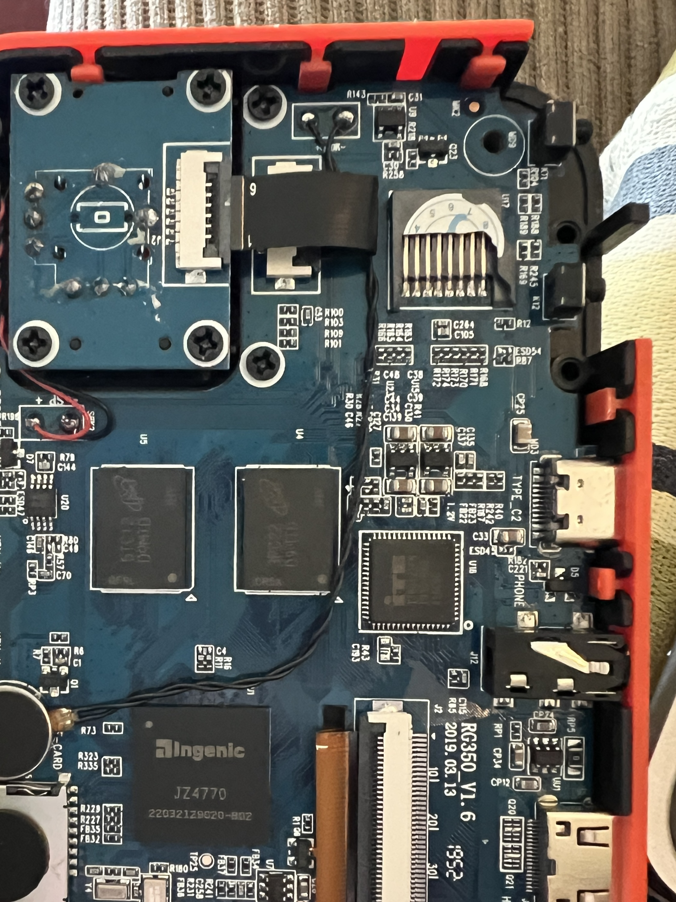

# plumOS JZ47xx_v2 User Guide

[日本語](README.ja.md) · [Project overview](../../README.md)

[Supported systems and ROM folders](supported-systems.md) · [SD card layout](storage.md) · [Save data and backups](save-data.md)

## Install on SD1

You need an RG280V, RG300X, RG350 or RG350M, a microSD card of at least 4 GB, and a card reader. Keep your original system card as a backup. Writing an image erases the destination card, including saves and settings.

1. Download `plumOS-JZ47xx-v0.1.0-sd-image.7z` and `SHA256SUMS` from the same release.
2. Verify the checksum before writing. For an individual file, use `shasum -a 256 <image-file>` on macOS, `sha256sum <image-file>` on Linux or `Get-FileHash <image-file> -Algorithm SHA256` in PowerShell. Compare the digest with the one published for that file.
3. Extract `plumOS-JZ47xx-0.1.0.img` from the 7-Zip archive. Select the IMG in a raw disk image writer. Check the destination card's name and capacity, write the image, let the writer finish verification and safely eject the card.
4. With the handheld powered off, insert the card into the [SD1 slot for your model](#sd-card-slots). Hold the direction for your model while turning it on. Release the direction when the plumOS logo appears.

| Handheld | Hold at power-on |
| --- | --- |
| RG280V | Up ↑ |
| RG300X | Right → |
| RG350 | Down ↓ |
| RG350M | Left ← |

Wait for the frontend to appear. On the card's first successful boot, the **SD SETUP** screen shows progress while plumOS expands SD1's user partition and creates the FAT32 `PLUMOS` volume. Keep the power on until the frontend appears. If your computer later prompts you to format an unfamiliar partition on SD1, dismiss the prompt and open the `PLUMOS` volume for your files.

## SD card slots

| Handheld | SD1 (plumOS system card) | SD2 (optional data card) |
| --- | --- | --- |
| RG280V, RG300X, RG350M | Slot marked **TF1/INT** | Slot marked **TF2/EXT** |
| RG350 | Internal microSD slot on the mainboard | Slot marked **TF** on the bottom edge of the case |

On the RG350, turn the handheld off and unplug any cables. Use a Phillips screwdriver to remove the back cover and reach the SD1 slot. It is near the R shoulder button, at the upper right in the photo below. Refit the back cover before powering on.



## Move the same SD1 to another model

Shut down before removing either card. On the new handheld, hold its direction during power-on. The direction overrides the previous selection. After a successful boot, the system remembers the new model on SD1. For later starts on that same handheld, turn it on normally. Moving SD1 does not run the card's setup again.

A new card has no remembered model and can wait at a black screen until you select one. If you move a card and see a lit but black screen, shut down and retry with the correct direction held **before** pressing Power.

## Update the runtime from SD1

1. Use the signed `.plu` package for JZ47xx_v2 from the release. Copy it to SD1's `PLUMOS/updates/` directory as `plumOS-JZ47xx-update.plu`.
2. Choose **START → System Settings → System Update**. The frontend checks the signature and update revision before restarting. Leave the device powered on until the frontend returns.
3. Open **System Settings → INFORMATION** and check the plumOS version against the release notes. If the updated frontend fails to start, the device restores the previous runtime and restarts the frontend.

If the device reports no compatible update, check the filename, the SD1 folder and whether the package is newer. Builds without **System Update** need an update-capable SD image first. Runtime updates preserve ROMs, BIOS files, saves and user settings. Kernel and boot file changes require an SD image.

## Add games and artwork

Use the `PLUMOS` volume on SD1, or use a separate FAT32 card in SD2. At startup, plumOS selects the `roms/` and `bios/` directories independently. Each uses the folder at the root of SD2 if present and falls back to the matching folder on SD1's `PLUMOS` volume otherwise. For example, with only `roms/` on SD2, games load from SD2 and BIOS files load from SD1. Each directory uses one card at a time. Put games and their artwork on the same card. To edit SD2, shut down and use a card reader.

```text
roms/
  nes/
    My Game.nes
  gamegear/
    My Game.gg
Images/
  nes/
    My Game.png
  gamegear/
    My Game.png
```

Use the [supported systems list](supported-systems.md) to choose a ROM folder and check its file extensions. Keep all files used by a disc game's CUE or playlist together and preserve the names it references.

For artwork, use the ROM's filename without its extension and place the PNG or JPEG in `Images/<system-id>/`. For example, use `Images/sfc/` for Super Nintendo artwork. On the frontend, choose **START → UI Settings → Refresh TOP** after adding games. Open a game list and press **X** to view its Gallery. Use the BIOS filenames and folder layout required by your emulator. [BIOS locations and examples](storage.md#bios-files-for-specific-emulators)

## OPK apps

**START → Apps** lists the OPK apps bundled with the image. The frontend does not discover OPKs copied to `apps/` on SD1's `PLUMOS` volume or on SD2. See the [developer guide](../developer/README.md#add-an-opk-to-a-development-card) for the development installation procedure.

## Alternative frontends

Launch SimpleMenu, 350teric, PyMenu or EmulationStation from **START → Apps**. Use the commands below to return to the plumOS frontend.

| Frontend | Return to plumOS |
| --- | --- |
| SimpleMenu | Press **START**, set **Session** to `quit`, then press **A**. |
| 350teric | Choose **Settings → Return to plumOS**. |
| PyMenu | From the main carousel, press **Down**, select the power icon and confirm **Return to plumOS**. |
| EmulationStation | Choose **START → RETURN TO PLUMOS**. |

## Controls and power

| Action | Control |
| --- | --- |
| Navigate, confirm and go back | D-pad, **A**, **B** |
| Open frontend settings | **START** |
| Open Gallery from a game list | **X** |
| Open available core options on a system | **SELECT** |
| Open the in-game emulator menu | **SELECT + START** on supported profiles |
| Open the plumOS power menu | Briefly press **Power** |
| Adjust brightness | Hold **START** and press left or right where supported |
| Adjust volume | Use the volume buttons where supported, or System Settings |

Use the emulator's **Exit** or **Quit** to return to the frontend. Use **Shutdown** in the plumOS power menu before removing a card. If you use **Sleep**, a short press of Power wakes the handheld. Game compatibility, emulator options and performance vary by title and device.

Back up important files before rewriting SD1. Standard emulator saves, states and settings are stored in SD1's managed partition. [Save paths and backup instructions](save-data.md)
